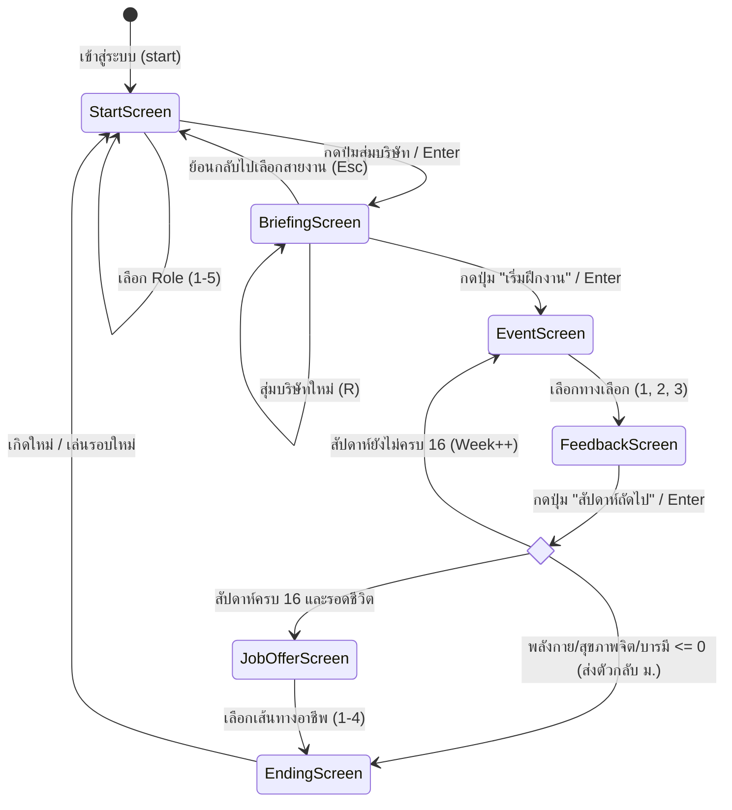

# Product Requirements Document (PRD)
## SE Intern Simulator: 16 สัปดาห์ชีวิตเด็กฝึกงานเอสอี
*(A Realistic Thai Software Engineering Internship Simulation)*

---

### ข้อมูลเอกสาร (Document Metadata)
- **ชื่อโครงการ:** SE Intern Simulator (ชีวิตเด็กฝึกงานเอสอี 16 สัปดาห์)
- **เวอร์ชัน:** 1.2.0
- **สถานะ:** Active / Production-Ready
- **ไฟล์โปรดักต์หลัก:** [`index.html`](file:///C:/Users/chont/.gemini/antigravity/scratch/swe-intern-game/index.html)
- **ประเภทซอฟต์แวร์:** Client-Side Single Page Application (Web Game & Interactive Educational Sim)
- **เทคโนโลยีหลัก:** HTML5, Vanilla JavaScript (ES6+), Tailwind CSS CDN, Web Audio API (Chiptune Synthesizer), Inline Scalable Vector Graphics (SVG)

---

## 1. วิสัยทัศน์และวัตถุประสงค์ (Vision & Objectives)

### 1.1 วิสัยทัศน์ (Vision)
สร้างเว็บเกมจำลองสถานการณ์เสมือนจริง (Realistic Life & Career Simulation) ที่สะท้อนชีวิตการฝึกงานและสหกิจศึกษาของนิสิต/นักศึกษาสายคอมพิวเตอร์และวิศวกรรมซอฟต์แวร์ (SE / CS / IT) ในประเทศไทย ตลอดระยะเวลา 16 สัปดาห์ (4 เดือนเต็ม) โดยจำลองปัจจัยชีวิตจริงรอบด้าน 100% ทั้งมิติด้านเทคนิค, วัฒนธรรมองค์กร, การบริหารความกดดัน และโครงสร้างการเงินค่าครองชีพในกรุงเทพมหานคร

### 1.2 วัตถุประสงค์หลัก (Core Objectives)
1. **Educational Simulation:** ให้ผู้เล่นได้เรียนรู้แนวปฏิบัติวิศวกรรมซอฟต์แวร์สากล (Software Engineering Best Practices) ผ่านสถานการณ์ปัญหาจริงที่อ้างอิงจากงานวิจัยและมาตรฐานอุตสาหกรรม (เช่น DORA Research, BABOK Guide, ISTQB, Nielsen Norman Group)
2. **Realistic Financial & Life Pressure:** จำลองการบริหารเงินค่าเบี้ยเลี้ยงเทียบกับค่าครองชีพจริง (ค่าเดินทาง BTS, ค่าอาหาร, ค่าเช่าหอพักรายเดือน) เพื่อสะท้อนความท้าทายของเด็กต่างจังหวัดและนิสิตที่เข้ามาฝึกงานใน กทม.
3. **Role Diversity:** ครอบคลุม 5 สายงานสำคัญในทีมพัฒนาซอฟต์แวร์ยุคใหม่ (DevOps/SRE, Software Developer, Business Analyst, QA Tester, UX/UI Designer)
4. **Zero Setup & Accessible:** เป็น Single-file Web Application ที่รันได้บนเบราว์เซอร์ทันทีโดยไม่ต้องติดตั้ง Backend หรือ Database รองรับทั้งคีย์บอร์ดลัด (Hotkeys) และการคลิกบนหน้าจออย่างสมบูรณ์

---

## 2. กลุ่มผู้ใช้เป้าหมาย (Target Audience & Personas)

| กลุ่มผู้ใช้ (Persona) | ลักษณะและภูมิหลัง | สิ่งที่คาดหวังจากระบบ |
| :--- | :--- | :--- |
| **นิสิต/นักศึกษาเตรียมฝึกงาน (Internship Candidates)** | นักศึกษาชั้นปีที่ 3-4 สาขา SE, CS, IT, CPE ที่กำลังจะออกสหกิจศึกษา | ได้เห็นภาพล่วงหน้าว่าบรรยากาศการทำงานจริงในแต่ละประเภทบริษัทเป็นอย่างไร และต้องเตรียมตัวรับมือกับอะไรบ้าง |
| **เด็กจบใหม่ & Junior Engineers** | บัณฑิตจบใหม่ที่เพิ่งเริ่มทำงานในสายเทค 0-2 ปี | ประสบการณ์สะท้อนชีวิตจริง (Relatable & Empathy) ย้อนรอยความทรงจำตอนฝึกงาน และวิเคราะห์ทางเลือกในอาชีพ |
| **อาจารย์นิเทศก์ & สถาบันการศึกษา** | อาจารย์ผู้ดูแลโครงการสหกิจศึกษาและฝึกงาน | สื่อการเรียนรู้เชิงโต้ตอบ (Interactive Learning Tool) ที่ช่วยให้นิสิตเข้าใจข้อบังคับ จรรยาบรรณวิชาชีพ และการรักษาสภาพจิตใจ/กาย |

---

## 3. สถาปัตยกรรมระบบและ State Machine (Architecture & Flow)

ระบบทำงานเป็น State-Driven Single Page Application โดยมี State Machine ควบคุมหน้าจอดังนี้:

---

## 4. ข้อกำหนดเชิงฟังก์ชัน (Functional Requirements)

### 4.1 ระบบเลือกตำแหน่งงาน (Role Selection System)
ระบบรองรับ 5 สายงานวิชาชีพ พร้อมค่าสถานะเริ่มต้น (Initial Baseline Stats):

| บทบาท (Role) | รหัส | จุดเน้นและความรับผิดชอบ | ทักษะ (Skill) | พลังกาย (Energy) | สุขภาพจิต (Sanity) | บารมี (Karma) | เงินเก็บ (Money) |
| :--- | :---: | :--- | :---: | :---: | :---: | :---: | :---: |
| **⚙️ DevOps & SRE** | `devops` | จัดการ Cloud, Docker, Kubernetes, CI/CD Pipeline และดับไฟระบบ | 36 | 80 | 70 | 42 | ฿4,000 |
| **💻 Software Dev** | `dev` | พัฒนา Core Feature, แก้บั๊ก, จัดการ Git Conflict และสปรินต์ | 35 | 85 | 75 | 40 | ฿4,000 |
| **📋 Business Analyst** | `ba` | เก็บ Requirement, เจรจากับลูกค้า, วาด Miro Flow, เขียน User Stories | 30 | 80 | 70 | 50 | ฿4,200 |
| **🧪 QA Tester** | `tester` | ออกแบบ Test Case, รัน Regression, สกัดบั๊กก่อนถึงโปรดักชัน | 32 | 85 | 80 | 42 | ฿4,000 |
| **🎨 UX/UI Designer** | `uxui` | ออกแบบ User Journey, ทำ Design System & Tokens, วาด Figma | 34 | 80 | 75 | 45 | ฿4,100 |

---

### 4.2 ระบบสุ่มและวิเคราะห์ประเภทบริษัท (Company Pool Engine)
เมื่อกดสุ่ม ระบบจะสุ่ม 1 ใน 4 ประเภทบริษัทจำลอง ซึ่งมีจุดเด่น วัฒนธรรมองค์กร และโครงสร้างการเงินแตกต่างกัน:

#### 1) 🚀 Tech Startup: HyperScale AI (อโศก)
- **ประเภทองค์กร:** สตาร์ทอัพเทคโนโลยีและปัญญาประดิษฐ์ (Deep Tech & AI)
- **วัฒนธรรม:** Casual, โครงสร้างแบนราบ, โซฟาบีนแบ็ก, กาแฟดริป, เบียร์ฟรีเย็นวันศุกร์
- **รูปแบบการทำงาน:** Agile สปรินต์ไว 1-2 สัปดาห์, Standup ทุกเช้า, สโคปงานกว้างมาก (Full-stack ยัน Cloud)
- **ข้อดี:** ได้จับงานโปรดักชันจริงตั้งแต่ Day 1, สปีดการเรียนรู้สูงมาก
- **ข้อควรระวัง:** ไม่มีพี่เลี้ยงประกบตลอดเวลา, สเปกเปลี่ยนไว, ต้องพึ่งพาตนเองสูง
- **โครงสร้างการเงิน:** เบี้ยเลี้ยง ฿750/วัน (~฿15,000/ด.), ค่าหออโศก ฿5,200/ด., ค่ากิน/BTS ฿1,500/สัปดาห์
- **ผลต่อค่าสถานะ (Traits):** ทักษะ +10, พลังกาย -5, สุขภาพจิต -5, บารมี +5, เงินตั้งต้น +฿2,000

#### 2) 🏛️ FinTech & Big Bank: Siam Cloud Financial Bank (สาทร)
- **ประเภทองค์กร:** สถาบันการเงินและองค์กรขนาดใหญ่ (Enterprise Banking & FinTech)
- **วัฒนธรรม:** เป็นทางการ, บัตรสแกน 5 ระดับ, ความปลอดภัยข้อมูลมาตรฐานสากล (ISO/IEC 27001, PCI-DSS)
- **รูปแบบการทำงาน:** Change Management รัดกุม, สิทธิ์เข้าถึง RBAC เข้มงวด, สปรินต์รอบไตรมาส
- **ข้อดี:** เบี้ยเลี้ยงสูงที่สุด, มีคอร์ส Onboarding และพี่เลี้ยงดูแล, เรซูเม่มีน้ำหนักสูง
- **ข้อควรระวัง:** ขอสิทธิ์ลงโปรแกรมใช้เวลานาน (Ticket 80 ขั้นตอน), แก้โค้ดต้องผ่านหลายโต๊ะอนุมัติ
- **โครงสร้างการเงิน:** เบี้ยเลี้ยง ฿900/วัน (~฿18,000/ด.), ค่าหอสาทร ฿5,800/ด., ค่ากิน/BTS ฿1,650/สัปดาห์
- **ผลต่อค่าสถานะ (Traits):** ทักษะ +5, พลังกาย -5, สุขภาพจิต +5, บารมี -5, เงินตั้งต้น +฿4,000

#### 3) ⚡ Software House: CyberCrafters Agency (อารีย์)
- **ประเภทองค์กร:** บริษัทรับพัฒนาซอฟต์แวร์ตามสัญญาจ้าง (Software House & Agency)
- **วัฒนธรรม:** ฮิปสเตอร์ย่านอารีย์, ครีเอทีฟ คึกคัก, ทีมลุยด้วยกัน, ช่วยกันแก้บั๊กดึกๆ มีของกินเลี้ยงประจำ
- **รูปแบบการทำงาน:** หมุนเวียนโปรเจกต์เร็ว, ใช้ Multi-Stack หลากหลายภาษาและ Framework
- **ข้อดี:** ได้แตะเทคโนโลยีหลากหลายที่สุด (React, Flutter, Go, Cloud, AI), แก้ปัญหาเก่งรอบด้าน
- **ข้อควรระวัง:** รับมือกับ Scope Creep และความต้องการลูกค้าที่เปลี่ยนไปมา, เดดไลน์ส่งมอบกระชั้นชิด
- **โครงสร้างการเงิน:** เบี้ยเลี้ยง ฿650/วัน (~฿13,000/ด.), ค่าหออารีย์ ฿4,800/ด., ค่ากิน/BTS ฿1,400/สัปดาห์
- **ผลต่อค่าสถานะ (Traits):** ทักษะ +15, พลังกาย -10, สุขภาพจิต -10, บารมี +10, เงินตั้งต้น +฿2,500

#### 4) 🏢 Public Sector: สถาบันพัฒนานวัตกรรมดิจิทัลภาครัฐ (แจ้งวัฒนะ)
- **ประเภทองค์กร:** รัฐวิสาหกิจและหน่วยงานดิจิทัลภาครัฐ (State Enterprise & Digital Gov)
- **วัฒนธรรม:** สงบ มั่นคง สุภาพ พี่เลี้ยงใจดี บรรยากาศไม่รีบเร่ง เลิกงาน 16:30 น. ตรงเวลา
- **รูปแบบการทำงาน:** เวลาทำงานมาตรฐาน 08:30 - 16:30 น., เอกสารบันทึกข้อความและระเบียบพัสดุชัดเจน
- **ข้อดี:** Work-Life Balance ดีที่สุด, ความเครียดและความกดดันต่ำ, ไม่ต้องเผางานข้ามคืน
- **ข้อควรระวัง:** เบี้ยเลี้ยงตามเพดานระเบียบราชการ (฿250/วัน), ระบบจัดซื้อและเซ็นเอกสารหลายขั้นตอน
- **โครงสร้างการเงิน:** เบี้ยเลี้ยง ฿250/วัน (~฿5,000/ด.), ค่าหอแจ้งวัฒนะ ฿3,800/ด., ค่ากิน/รถเมล์ ฿1,100/สัปดาห์
- **ผลต่อค่าสถานะ (Traits):** ทักษะ -5, พลังกาย +15, สุขภาพจิต +15, บารมี +15, เงินตั้งต้น +฿1,500

---

### 4.3 หน้าปฐมนิเทศและสรุปข้อมูลนิสิตฝึกงาน (Briefing & Onboarding Screen)
หน้านี้ทำหน้าที่เป็นจุดเชื่อมโยง (Bridge) ก่อนเข้าสู่เกมสัปดาห์ที่ 1 ประกอบด้วย:
1. **คอลัมน์ซ้าย (Company Profile & Deep Dive):**
   - แสดงกราฟิกและ Badge ของบริษัท
   - รายละเอียดประเภทบริษัท, โมเดลธุรกิจ, รูปแบบการทำงาน, วัฒนธรรมองค์กร
   - สรุปจุดเด่น (ข้อดี) vs ข้อควรระวัง (ความท้าทาย)
   - โครงสร้างการเงิน: เบี้ยเลี้ยงรายวัน, ค่ากินรายสัปดาห์, ค่าหอรายเดือน
   - บัฟ/ดีบัฟผลกระทบต่อค่าสถานะ
2. **คอลัมน์ขวา (All Interns Summary & Start Button):**
   - **นิสิตฝึกงานที่คุณเล่น (Active Player):** แสดงแถบพลังกาย, สุขภาพจิต, ทักษะ, บารมี, และเงินเก็บเริ่มต้นสุทธิ
   - **สรุปนิสิตฝึกงานร่วมรุ่นทั้งหมด 5 สายงาน (Cohort Roster):** การ์ดสรุปย่อแสดงบทบาทหน้าที่ของเพื่อนร่วมรุ่นทั้ง 5 คน พร้อมระบุว่าคนไหนคือตัวคุณ
   - **ปุ่มเริ่มฝึกงาน (Start Button):** ปุ่มสีทองเด่นชัด `[ 🚀 เริ่มต้นฝึกงาน สัปดาห์ที่ 1 (เข้าสู่ชีวิตจริง) ]` (กด `Enter`)
   - **ปุ่มเสริม:** `[ 🎲 สุ่มบริษัทใหม่ (R) ]` และ `[ ⟵ เปลี่ยนตำแหน่งงาน (Esc) ]`

---

### 4.4 ระบบจำลอง 16 สัปดาห์สหกิจศึกษา (16-Week Simulation Engine)
- สัปดาห์ที่ 1 - 16 แต่ละสัปดาห์จะมีเหตุการณ์เฉพาะสายงาน (Role-specific Dilemmas) รวม 80 เหตุการณ์
- แต่ละเหตุการณ์มี 3 ตัวเลือกการตัดสินใจ พร้อมแสดงการเปลี่ยนแปลงของค่าสถานะและค่าใช้จ่าย
- มีการอ้างอิงแหล่งข้อมูลวิจัยทางวิชาการ (Research References) เช่น IEEE Software, DORA Report, BABOK, ISTQB, Nielsen Norman Group

---

### 4.5 ระบบการเงินและกระแสเงินสดจำลอง (Cashflow Engine)
ระบบคำนวณการเงินทุกสิ้นสัปดาห์โดยจำลองกระแสเงินสดจริง:
$$\Delta \text{Money} = (\text{Working Days} \times \text{Daily Stipend}) + \text{OT Bonus} - \text{Weekly Living Cost} - \text{Monthly Rent (if applicable)}$$

- **Working Days:** ปกติ 5 วันทำการ (จำลองวันหยุดนักขัตฤกษ์สัปดาห์ที่ 3, 7, 13 ทำให้ทำงาน 4 วัน)
- **OT Bonus:** สัปดาห์ที่ทำงานล่วงเวลาฉุกเฉิน
- **Weekly Living Cost:** ค่าอาหารและค่าเดินทาง BTS/MRT หักทุกวันศุกร์
- **Monthly Rent:** หักค่าเช่าหอพักอัตโนมัติทุกสิ้นเดือน (สัปดาห์ที่ 4, 8, 12, 16)
- **หนี้สิน:** หากเงินในบัญชีติดลบ จะเกิดภาวะหนี้สินและส่งผลกระทบต่อเนื่องต่อสุขภาพจิต

---

### 4.6 เงื่อนไขการสิ้นสุดเกม (Endings & Game Over)
1. **การถูกส่งตัวกลับมหาวิทยาลัย (Fail State / Sent Back - ติด F สหกิจ):**
   - พลังกาย (Energy) $\le 0$: ล้มป่วยหนักจากการโหมงาน ร่างกายพัง แพทย์สั่งพัก
   - สุขภาพจิต (Sanity) $\le 0$: ภาวะหมดไฟรุนแรง (Severe Burnout / Breakdown) ขอยอมแพ้
   - บารมี/สายสัมพันธ์ (Karma) $\le 0$: ทำผิดพลาดร้ายแรงและขาดความรับผิดชอบจนหัวหน้าประเมินให้ไม่ผ่าน
2. **การจบสหกิจศึกษาอย่างสมบูรณ์ (Graduation & Win States):**
   - **🏆 S-Tier Return Offer:** คะแนนรวมโดดเด่น ได้รับข้อเสนอจ้างงานประจำทันทีพร้อมเงินเดือนระดับท็อป
   - **🥈 A-Tier Passed with Honors:** ผ่านเกณฑ์ระดับดีเยี่ยม มีผลงานเด่นในพอร์ตโฟลิโอ
   - **🥉 B-Tier Solid Completion:** ผ่านการฝึกงานตามเกณฑ์มาตรฐาน ได้เรียนรู้บทเรียนชีวิตจริง
3. **ระบบเลือกเส้นทางอาชีพหลังจบ (Week 16 Career Choice):**
   - ทางเลือกที่ 1: เซ็นสัญญาพนักงานประจำทันที (Full-time)
   - ทางเลือกที่ 2: ขอเป็น Part-time ระหว่างเรียนเทอมสุดท้าย
   - ทางเลือกที่ 3: ปฏิเสธเพื่อเตรียมตัวสอบสัมภาษณ์ Big Tech
   - ทางเลือกที่ 4: ขอพักผ่อนฟื้นฟูสภาพจิตใจ (Gap Period)

---

## 5. การออกแบบประสบการณ์และส่วนติดต่อผู้ใช้ (UI/UX & Audio)

### 5.1 ธีมและการออกแบบภาพ (Visual & Aesthetic)
- **Color Palette:**
  - พื้นหลังหลัก: Midnight Blue Deep Canvas (`#080f24`, `#0d1736`)
  - กล่องขอบทองเด่น (Gold Accents): (`#dfbd69`, `#e5a83b`) สไตล์พรีเมียม
  - เฉดสีสถานะ: ❤️ แดง (Health/Energy), 😊 เหลือง (Sanity), 📘 ฟ้าคราม (Skill), 👔 เขียวหัวเป็ด (Karma), 💰 ทองคำ (Money)
- **Pixel & Modern Fusion:** ผสมผสานฟอนต์ยุคเรโทร (`Press Start 2P`, `Silkscreen`) เข้ากับฟอนต์ภาษาไทยอ่านง่าย (`Kanit`) พร้อมภาพประกอบ Pixel SVG

### 5.2 ระบบเสียงสังเคราะห์ (Web Audio API Synthesizer)
สร้างเสียงเอฟเฟกต์แบบ Chiptune 8-bit ด้วย Web Audio Oscillator โดยไม่ต้องโหลดไฟล์ภายนอก:
- `click`: เสียงคลิกปุ่มสั้นกระชับ
- `select`: เสียงเลือกสายงาน
- `success`: เสียงเมโลดี้ความสำเร็จ (Arpeggio สูงขึ้น)
- `warning`: เสียงแจ้งเตือนความผิดพลาด
- `money`: เสียงรับเงินเบี้ยเลี้ยง
- `gameover`: เสียงแจ้งเตือนเกมโอเวอร์

### 5.3 การควบคุมด้วยคีย์บอร์ด (Keyboard Shortcuts)
| หน้าจอ (Screen) | แป้นพิมพ์ที่รองรับ | การทำงาน (Action) |
| :--- | :---: | :--- |
| **Start Screen** | `1`, `2`, `3`, `4`, `5` | เลือก Role 1 ถึง 5 |
| | `Enter` / `Space` | สุ่มบริษัทและเข้าสู่หน้าสรุปข้อมูล |
| **Briefing Screen** | `Enter` / `Space` | **เริ่มต้นฝึกงาน สัปดาห์ที่ 1** |
| | `R` / `r` | สุ่มบริษัทใหม่ (Reroll) |
| | `Esc` / `Backspace` | ย้อนกลับไปหน้าเลือกสายงาน |
| **Event Screen** | `1`, `2`, `3` | ตัดสินใจเลือกทางเลือก 1, 2 หรือ 3 |
| **Feedback Screen** | `Enter` / `Space` | ดำเนินการต่อสัปดาห์ถัดไป |
| **Ending Screen** | `Enter` / `Space` | เกิดใหม่ / เริ่มต้นเล่นรอบใหม่ |

---

## 6. ข้อกำหนดเชิงเทคนิคและประสิทธิภาพ (Non-Functional Requirements)

1. **Zero External Backend / Standalone:** ทำงานแบบ Client-Side 100% บนไฟล์ `index.html` เพียงไฟล์เดียว สามารถเปิดเล่นแบบ Local หรือโฮสต์บน Static Web Server (เช่น GitHub Pages, Vercel) ได้ทันที
2. **Fast Load Time & Lightweight:** ไม่มี Dependencies ขนาดใหญ่ ใช้ Tailwind CDN และฟอนต์ Google Fonts ทำเวลาโหลดหน้าเว็บแรกเริ่ม &lt; 1.5 วินาที
3. **Cross-Browser Compatibility:** รองรับ Google Chrome, Microsoft Edge, Safari, Firefox
4. **Responsive Layout:** รองรับการแสดงผลหน้าจอมือถือ, แท็บเล็ต และหน้าจอเดสก์ท็อป โดยควบคุมความกว้างสูงสุดที่ `max-w-5xl` เพื่อลดความเมื่อยล้าสายตา

---

## 7. แผนพัฒนาในอนาคต (Future Roadmap)

- **v1.3:** ระบบ Random Incident สุ่มเหตุการณ์ฉุกเฉินประจำสัปดาห์ (เช่น รถไฟฟ้า BTS เสีย, ดราฟต์โปรดักชันล่ม, ตู้เย็นออฟฟิศหาย)
- **v1.4:** ระบบบันทึกสถิติ (Local Storage Achievements & Hall of Fame) เก็บคอลเลกชันฉากจบและเรซูเม่
- **v2.0:** โหมดจำลองทีมคู่ขนาน (Multi-Intern Cohort Dynamic) ที่ผลการตัดสินใจของเราส่งผลกระทบต่อเพื่อนร่วมรุ่นในบริษัทเดียวกัน

---

*เอกสารฉบับนี้จัดทำขึ้นเพื่อใช้เป็นข้อกำหนดผลิตภัณฑ์มาตรฐานสำหรับโครงการ **SE Intern Simulator***
*(อัปเดตล่าสุด: พฤศจิกายน 2026)*
